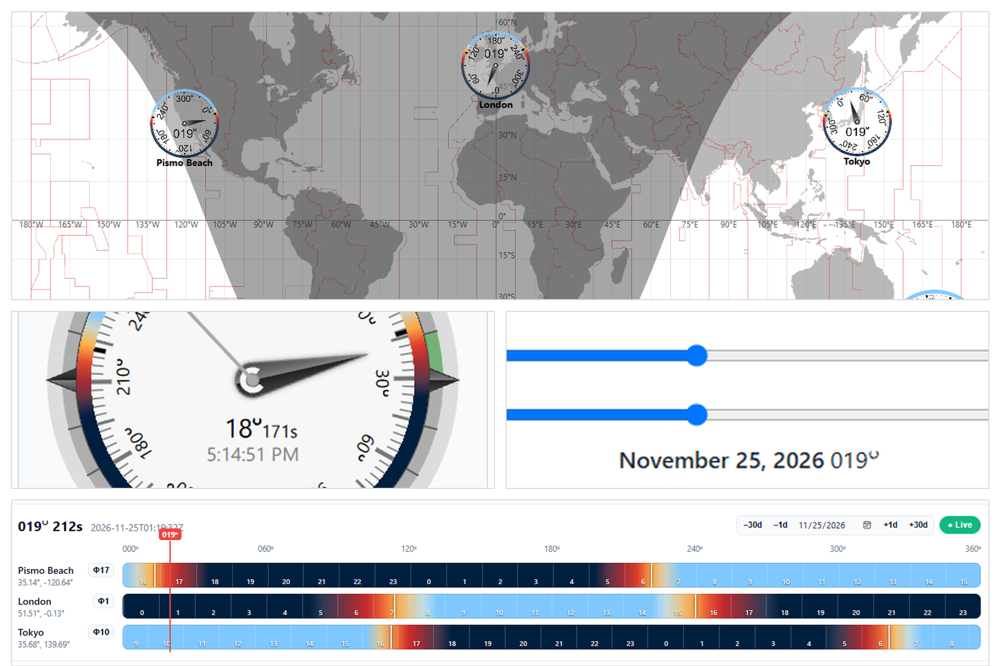
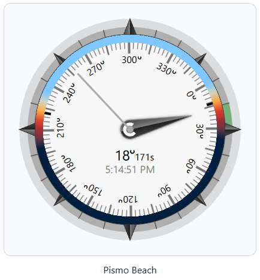
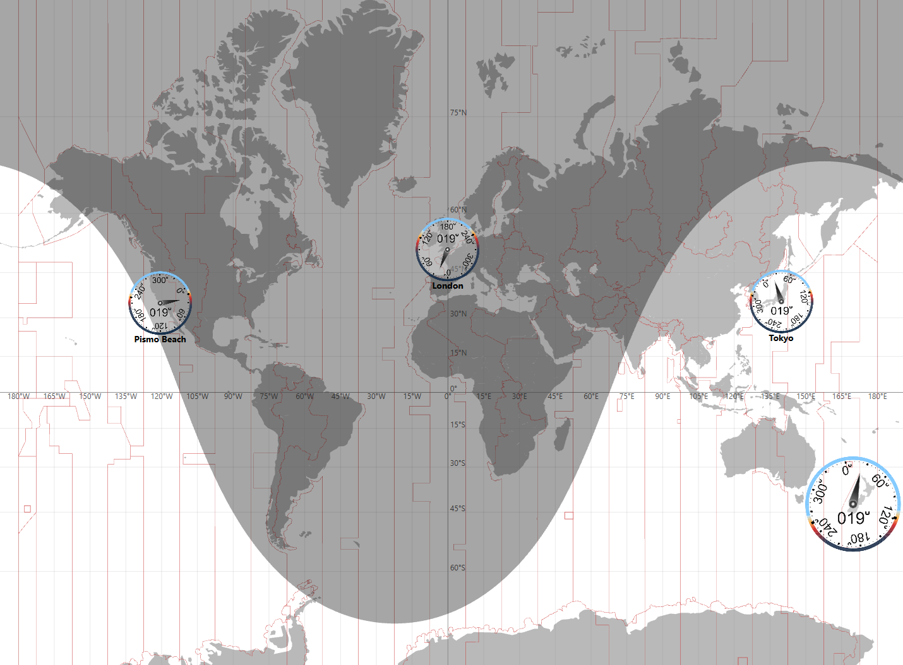
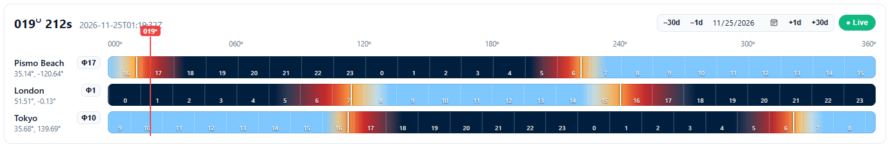
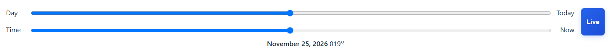
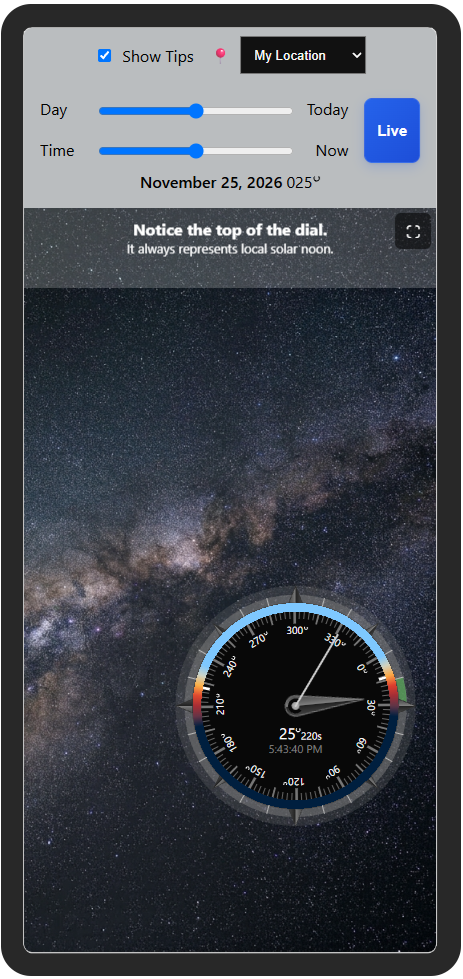

# umi-widgets

> Framework-independent Web Components for Umi-Time.

`umi-widgets` provides a collection of reusable custom elements for displaying, exploring, and teaching Umi-Time on the web.

Whether you're building a full Umi-Time application, embedding a live clock on a website, or creating educational tools, `umi-widgets` offers ready-to-use components that work in plain HTML and modern frameworks including React, Vue, Svelte, Ember, Angular, and more.

✅ Framework-independent  
✅ TypeScript support  
✅ Solar-aware visualizations  
✅ Interactive educational tools  
✅ Modular imports  
✅ Built on top of `umi-time`

---

## What is Umi-Time?

Umi-Time is an alternative timekeeping system built around a decimalized day.

A complete day contains:

- 240 umi
- 1 umi = 1000 seconds
- Geographic longitude can be incorporated directly into time calculations
- Visualizations can account for daylight and solar position

The widgets in this package make it easy to display, visualize, and explore Umi-Time without building custom UI components from scratch.

Learn more at the Umi-Time project website.

---

## Widget Gallery



### Included Widgets

| Widget | Purpose |
|----------|----------|
| `umi-clock` | Live analog and digital Umi-Time clock |
| `umi-display` | Human-friendly formatted output |
| `umi-time` | Canonical Umi-Time representation |
| `umi-world-map` | Global visualization |
| `umi-timeline` | Multi-location comparison |
| `umi-time-explorer` | Interactive educational explorer |
| `umi-timezones` | Regional time comparison |

---

## Quick Start

### Install

```bash
npm install umi-widgets
```

### Register all widgets

```ts
import "umi-widgets";
```

### Use in HTML

```html
<umi-clock
  latitude="35.121"
  longitude="-120.641"
  size="400px">
</umi-clock>
```

---

## Featured Widgets

### umi-clock

A live Umi-Time clock with optional location, solar, and educational features.



```html
<umi-clock
  latitude="35.121"
  longitude="-120.641">
</umi-clock>
```

---

### umi-world-map

Visualize Umi-Time around the world.



```html
<umi-world-map></umi-world-map>
```

---

### umi-timeline

Compare local time across multiple locations.



```html
<umi-timeline></umi-timeline>
```

---

### umi-time-explorer

Explore relationships between date, season, longitude, solar position, and Umi-Time.



```html
<umi-time-explorer></umi-time-explorer>
```

---

## Framework Support

Because every widget is built using standards-based Web Components, they can be used in virtually any modern framework.

### React

```tsx
import "umi-widgets";

export default function App() {
  return <umi-clock />;
}
```

### Vue

```vue
<template>
  <umi-clock />
</template>

<script setup>
import "umi-widgets";
</script>
```

### Svelte

```svelte
<script>
  import "umi-widgets";
</script>

<umi-clock />
```

### Ember

```js
// app.js
import "umi-widgets";
```

```hbs
<UmiClock />
```

Alternatively, invoke the custom element directly:

```hbs
<umi-clock></umi-clock>
```

### Angular

```ts
import "umi-widgets";
```

```html
<umi-clock></umi-clock>
```

---

## Modular Imports

Import only the widgets you need.

```ts
import "umi-widgets/elements/umi-clock";
```

```ts
import "umi-widgets/elements/umi-world-map";
```

```ts
import "umi-widgets/elements/umi-time-explorer";
```

This can reduce bundle size by avoiding registration of unused components.

---

## Educational Applications

The widget library was designed not only for displaying Umi-Time, but also for teaching it.

Use cases include:

- Interactive demonstrations
- Classroom presentations
- Personal learning tools
- Experimental calendar systems
- Geography and longitude visualizations
- Solar and daylight exploration

---

## Mobile Friendly



Widgets are designed to work across desktop and mobile devices.

---

## Development

Install dependencies:

```bash
npm install
```

Start the development server:

```bash
npm run dev
```

Build the project:

```bash
npm run build
```

Run tests:

```bash
npm test
```

---

## Documentation

See the project documentation for:

- Component reference
- Attributes and properties
- Methods and events
- Framework-specific guidance
- Advanced examples

---

## Contributing

Contributions, ideas, bug reports, and improvements are welcome.

Please open an issue or submit a pull request.

---

## License

MIT